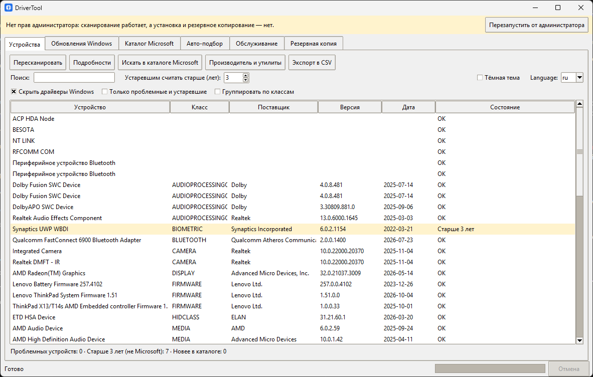
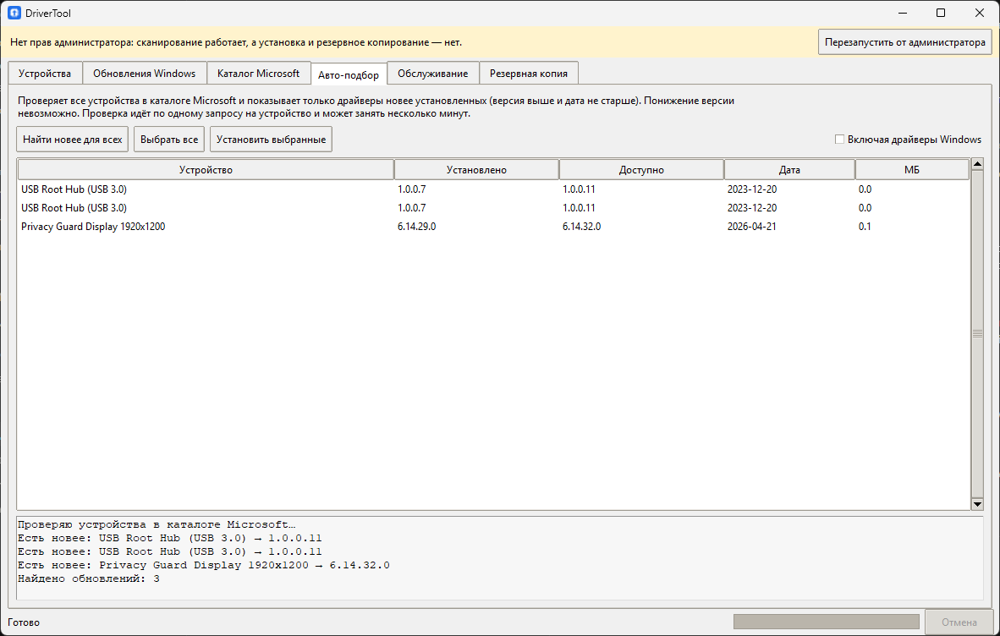
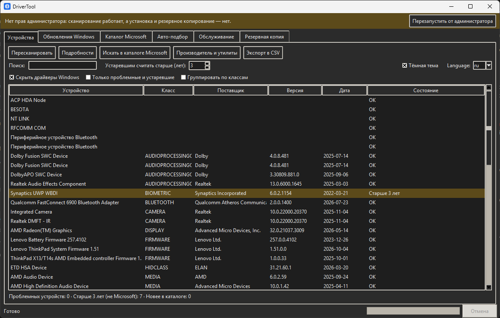
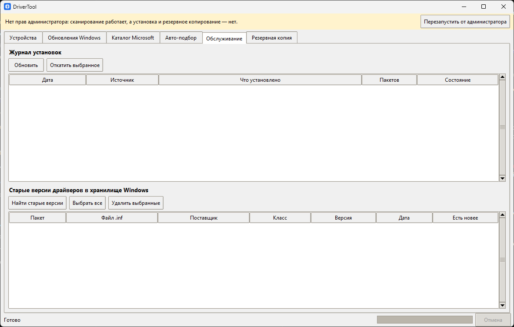

# DriverTool

Утилита для обновления драйверов Windows — без рекламы, без сторонних установщиков и телеметрии.
A clean Windows driver updater — no ads, no bundled software, no telemetry.

Драйверы берутся только из двух официальных источников: Windows Update и каталога Microsoft Update.
Установка всегда по вашей команде и только с подтверждением.



## Возможности
- **Устройства:** список драйверов, подсветка проблемных и устаревших (порог настраивается), группировка по классам,
  поиск, сортировка, подробности, экспорт в CSV, страницы производителя и фирменные утилиты через winget
- **Авто-подбор:** проверяет все устройства в каталоге Microsoft и показывает только настоящие обновления —
  версия выше и дата не старше установленной, понизить драйвер нельзя
- **Каталог Microsoft:** поиск по коду оборудования, скачивание `.cab` с докачкой при обрыве, проверка SHA-256
  и подписи Microsoft, установка через `pnputil`, проверка места на диске
- **Обновления Windows:** поиск и установка драйверов через Windows Update
- **Журнал и откат:** каждая установка записывается; откат удаляет добавленные ею пакеты, и Windows возвращается
  к предыдущему драйверу
- **Обслуживание:** удаление старых версий из хранилища драйверов, список изменений относительно снимка,
  быстрый доступ к точкам восстановления
- **Резервная копия** и восстановление сторонних драйверов
- Перед установкой: снимок версий и (по желанию) точка восстановления
- Индикатор прогресса, отмена (Esc), горячие клавиши, тёмная тема, русский и английский интерфейс,
  сохранение размера окна и колонок, журнал работы в файл

Подробные сценарии: [docs/SCENARIOS.md](docs/SCENARIOS.md).

| Авто-подбор | Тёмная тема | Обслуживание |
|---|---|---|
|  |  |  |

## Запуск
Готовый `DriverTool.exe` — на странице [Releases](../../releases). Либо из исходников
(Windows 10/11, Python 3.10+, только стандартная библиотека):

```
python app.py
```

Для установки, очистки и резервного копирования нужны права администратора — программа предложит перезапуск.
Данные программы (настройки, журнал, снимки, лог): `%LOCALAPPDATA%\DriverTool`.

## Известные ограничения
- Windows Update и каталог Microsoft содержат не все драйверы. Свежие драйверы видеокарт NVIDIA и AMD там
  часто отстают от сайтов производителей; для них программа открывает официальную страницу загрузки
  (в winget этих драйверов нет).
- Каталог Microsoft разбирается как веб-страница: если Microsoft изменит вёрстку, поиск в каталоге
  перестанет работать до обновления программы.
- Совпадение драйвера определяется по коду оборудования. Проверьте дату и версию перед установкой —
  автоматический подбор может предложить драйвер, который вам не нужен.
- Откат удаляет пакеты, добавленные установкой. Если после неё Windows выбрала другой драйвер, чем предыдущий,
  используйте точку восстановления или резервную копию.
- `.exe` не подписан сертификатом, поэтому SmartScreen может показать предупреждение.
- Установка, откат, очистка и резервное копирование проверены ограниченно: тестируйте на своей системе
  и держите точку восстановления включённой.
- Язык интерфейса меняется после перезапуска.

## Разработка
```
python -m unittest discover -s tests -v          # тесты
python tools/make_icon.py                        # пересоздать иконку
python -m pip install pyinstaller
python -m PyInstaller --noconfirm --onefile --windowed --name DriverTool --icon icon.ico --add-data "scripts;scripts" --add-data "icon.ico;." app.py
```
Релиз собирается автоматически: тег `vX.Y.Z` → GitHub Actions соберёт `.exe` и приложит к релизу.

## Лицензия
[MIT](LICENSE)
